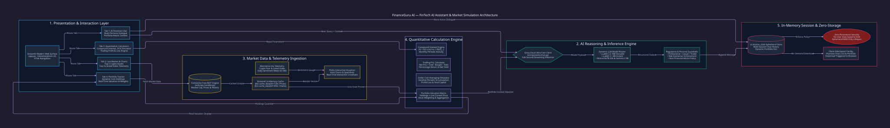
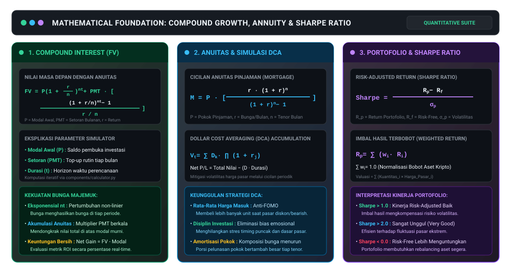
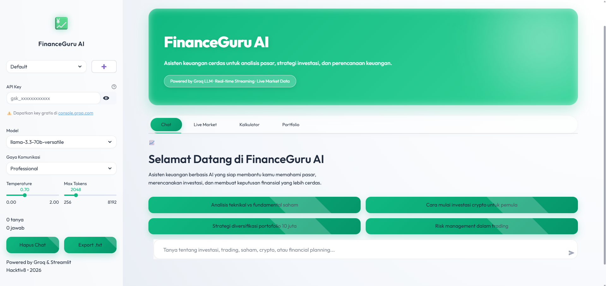
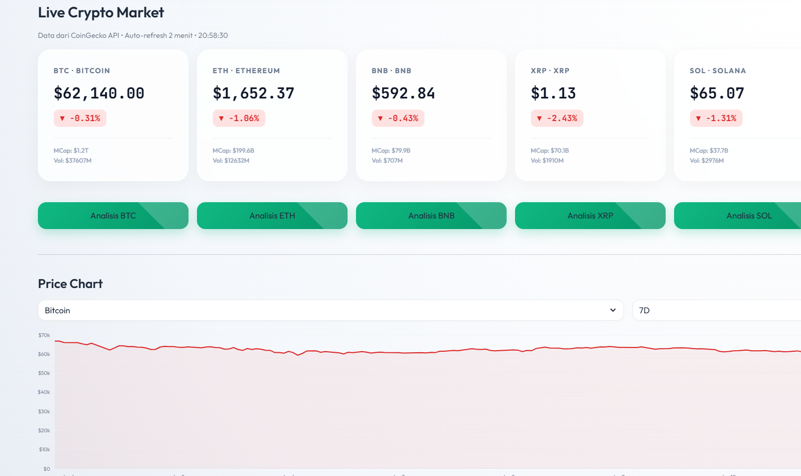
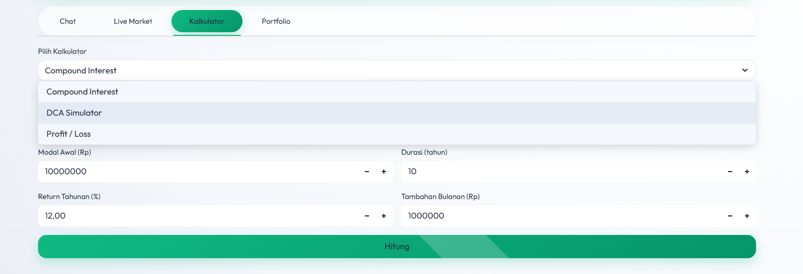
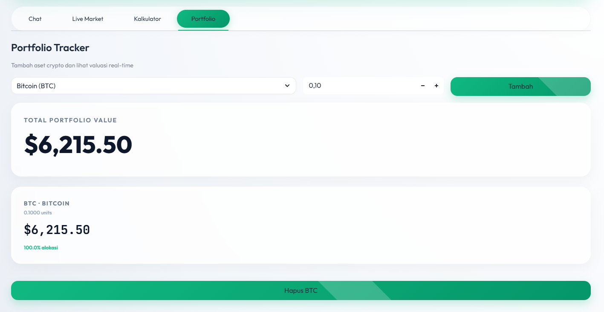

<div align="center">
  <br />
  <h1 align="center">💹 FinanceGuru AI — Smart FinTech &amp; Market Intelligence</h1>
  <p align="center"><i>AI-DRIVEN FINANCIAL ASSISTANT · GROQ LPU INFERENCE · REAL-TIME MARKET TELEMETRY · QUANTITATIVE MODELING</i></p>

  <a href="https://finance-guru-ai.streamlit.app" target="_blank">
    
  </a>
  <br />

  <p align="center">
    <a href="https://finance-guru-ai.streamlit.app" target="_blank">
      
    </a>
  </p>

  <p align="center">
    
    
    
    
    
    
    
    
  </p>

  <p align="center" style="max-width: 860px; font-size: 1.05rem; color: #94a3b8; line-height: 1.6;">
    <b>FinanceGuru AI</b> adalah platform asisten keuangan cerdas dan simulasi pasar (<i>FinTech AI Assistant &amp; Market Intelligence Dashboard</i>) yang menggabungkan inferensi model bahasa berkecepatan tinggi via <b>Groq LPU (Language Processing Unit)</b> dengan pemodelan finansial kuantitatif dan telemetri pasar kripto waktu riil. Dilengkapi antarmuka modular berestetika <i>Dark Glassmorphism</i>, sistem ini menyediakan analisis fundamental terstruktur, simulasi pertumbuhan bunga majemuk, kalkulator anuitas cicilan, pemantau sentimen pasar <i>Fear &amp; Greed</i>, serta pelacak portofolio aset multi-koin secara <i>in-memory</i> tanpa menyimpan data sensitif pengguna ke disk server.
  </p>
</div>

<p align="center"></p>

## 🏛️ Arsitektur Sistem 5-Layer FinTech AI &amp; Simulasi Pasar

Sistem mengadopsi arsitektur 5 layer modular yang memisahkan antarmuka interaktif, mesin penalaran AI, telemetri pasar eksternal, pemodelan kuantitatif, dan manajemen sesi memori:

<p align="center">
  
</p>

<p align="center"></p>

## ⚡ Fitur Rekayasa Unggulan

<table align="center" width="100%">
  <tr>
    <td width="50%" valign="top">
      <b>💬 Asisten Finansial Cerdas Berbasis Groq LPU</b><br/>
      Inferensi percakapan berkecepatan sub-detik memanfaatkan perangkat keras akselerator Groq LPU. Mendukung <i>Model Router</i> dinamis (<code>llama-3.3-70b-versatile</code>, <code>llama-3.1-8b-instant</code>, <code>mixtral-8x7b-32768</code>) dengan 3 persona komunikasi: <i>Professional Analyst</i>, <i>Santai &amp; Edukatif</i>, dan <i>Trader Mode</i>.
    </td>
    <td width="50%" valign="top">
      <b>📈 Telemetri Pasar Kripto &amp; Visualisasi Plotly</b><br/>
      Pemantauan aset digital kapitalisasi pasar teratas (Bitcoin, Ethereum, Solana, BNB, XRP) secara <i>real-time</i> via CoinGecko REST API dengan caching bertingkat (TTL 120s). Dilengkapi grafik area interaktif Plotly dengan visualisasi pergerakan harga 7 hari dan tooltip harga instan.
    </td>
  </tr>
  <tr>
    <td width="50%" valign="top">
      <b>🎯 Indeks Sentimen Pasar (Fear &amp; Greed Meter)</b><br/>
      Integrasi telemetri sentimen pasar global harian dari Alternative.me (skala 0–100) yang memetakan psikologi pasar: <i>Extreme Fear</i> (&lt; 25), <i>Fear</i> (25–49), <i>Neutral</i> (50), <i>Greed</i> (51–74), hingga <i>Extreme Greed</i> (&ge; 75) untuk navigasi momentum investasi.
    </td>
    <td width="50%" valign="top">
      <b>🧮 Pemodelan Finansial Kuantitatif (Simulator Suite)</b><br/>
      Kalkulator matematis deterministik mencakup kalkulator <b>Compound Interest</b> dengan setoran bulanan anuitas, simulator <b>Dollar Cost Averaging (DCA)</b> dengan perhitungan bunga akumulatif bulanan, serta kalkulator <b>Trading Profit/Loss</b> dengan potongan biaya komisi transaksi.
    </td>
  </tr>
  <tr>
    <td width="50%" valign="top">
      <b>💼 Pelacak Portofolio Multi-Aset Dinamis</b><br/>
      Manajemen kepemilikan aset kripto dengan agregasi nilai pasar terbobot secara otomatis. Memetakan kuantitas koin ke valuasi USD dan IDR terkini, menghitung komposisi bobot portofolio, dan menginjeksikan ringkasan aset langsung ke <i>context window</i> asisten AI untuk konsultasi terarah.
    </td>
    <td width="50%" valign="top">
      <b>🔒 Keamanan Sesi In-Memory &amp; Zero Disk Residue</b><br/>
      Seluruh riwayat obrolan, daftar kepemilikan aset portofolio, dan hasil kalkulasi finansial disimpan secara eksklusif di memori sesi RAM (<code>st.session_state</code>). Sistem menjamin nol persistensi data keuangan pribadi ke disk peladen dengan fitur ekspor mandiri format <code>.txt</code> langsung di browser.
    </td>
  </tr>
</table>

<p align="center"></p>

## 🧮 Formulasi Matematika Finansial &amp; Evaluasi Risiko

Seluruh landasan matematis komputasi bunga majemuk anuitas, simulasi akumulasi Dollar Cost Averaging, cicilan amortisasi pinjaman, serta rasio imbal hasil terhadap volatilitas risiko (Sharpe Ratio) disajikan dalam kartu vektor beresolusi tinggi berikut:

<p align="center">
  
</p>

### Ringkasan Tahapan Komputasi &amp; Formula Finansial

| Komponen Finansial | Formulasi Matematis Utama | Variabel Operasional | Peran dalam Sistem |
|---|---|---|---|
| **1. Bunga Majemuk Anuitas** | FV = P (1 + r/n)^(nt) + PMT · [ ((1 + r/n)^(nt) − 1) / (r/n) ] | P: Modal Awal, r: Bunga Tahunan, n: 12 Bulan, t: Tahun, PMT: Setoran Bulanan | Menghitung proyeksi pertumbuhan modal investasi jangka panjang |
| **2. Akumulasi Investasi DCA** | V_t = Σ D_k · Π (1 + r_j) | D_k: Investasi Rutin Bulanan, r_j: Estimasi Return Bulanan, t: Durasi Bulan | Menghitung akumulasi nilai portofolio dengan mitigasi volatilitas |
| **3. Net Trading Profit/Loss** | Net_PL = Total_Jual − Total_Beli − Fee_Transaksi | Harga_Beli, Harga_Jual, Kuantitas Unit, Persentase Biaya Transaksi | Evaluasi imbal hasil trading bersih setelah potongan biaya broker |
| **4. Cicilan Anuitas Pinjaman** | M = P · [ (r (1 + r)^n) / ((1 + r)^n − 1) ] | P: Pokok Pinjaman, r: Bunga per Periode, n: Total Tenor Cicilan | Menghitung angsuran bulanan tetap dengan amortisasi pokok menurun |
| **5. Imbal Hasil Portofolio** | R_p = Σ (w_i · R_i) dengan Σ w_i = 1.0 | w_i: Bobot Valuasi Aset i, R_i: Imbal Hasil Historis Aset i | Menghitung tingkat pengembalian modal gabungan multi-kripto |
| **6. Sharpe Ratio (Risk-Adjusted)** | Sharpe = (R_p − R_f) / σ_p | R_p: Return Portofolio, R_f: Suku Bunga Bebas Risiko, σ_p: Volatilitas | Mengukur apakah keuntungan portofolio sebanding dengan risiko |

<p align="center"></p>

## 📸 Antarmuka Sistem (Premium Glassmorphism Dashboard)

Sistem menyajikan antarmuka modern dengan tipografi bersih, pembatas hairline, serta visualisasi data interaktif:

<table align="center" width="100%">
  <tr>
    <td width="50%" align="center">
      <b>Asisten Chatbot AI Finansial (Groq LLaMA 3.3)</b><br/>
      
    </td>
    <td width="50%" align="center">
      <b>Telemetri Pasar Kripto &amp; Fear/Greed Index</b><br/>
      
    </td>
  </tr>
  <tr>
    <td width="50%" align="center" valign="middle">
      <b>Kalkulator Finansial Kuantitatif</b><br/>
      
    </td>
    <td width="50%" align="center" valign="middle">
      <b>Pelacak Alokasi Portofolio Investasi</b><br/>
      
    </td>
  </tr>
</table>

<p align="center"></p>

## 📂 Struktur Direktori Repositori

```text
finance-guru-ai/
├── assets/
│   ├── architecture.svg              # Diagram arsitektur 5-layer kompilasi D2 (Terminal Dark)
│   ├── financial_formulas.svg        # Kartu vektor formulasi Compound Interest & Sharpe Ratio
│   ├── style.css                     # Lembar gaya kustom antarmuka Glassmorphism Streamlit
│   ├── dashboard_chat.png            # Tangkapan layar antarmuka asisten AI chat
│   ├── Live_Market.png               # Tangkapan layar antarmuka live market & fear/greed
│   ├── Kalkulator.png                # Tangkapan layar antarmuka kalkulator compound interest
│   └── Portofolio.png                # Tangkapan layar antarmuka manajemen portofolio
├── components/
│   ├── calculator.py                 # Komponen kalkulator finansial (Compound, DCA, PnL)
│   ├── chat.py                       # Komponen chat AI, integrasi Groq LPU, & prompt persona
│   ├── market.py                     # Komponen live market, grafik Plotly, & Fear/Greed index
│   └── portfolio.py                  # Komponen pelacak portofolio aset & valuasi real-time
├── docs/
│   └── architecture.d2               # Kode sumber deklaratif D2 arsitektur sistem
├── img/                              # Sumber tangkapan layar antarmuka bawaan
├── utils/
│   └── api_handler.py                # Handler REST API eksternal (CoinGecko & Alternative.me)
├── app.py                            # Titik masuk utama aplikasi web Streamlit
├── requirements.txt                  # Dependensi runtime Python (streamlit, groq, plotly, requests)
├── .env.example                      # Template variabel lingkungan (GROQ_API_KEY)
├── .gitignore                        # Filter proteksi secrets, environment, dan data pengguna
└── LICENSE                           # Lisensi resmi MIT (Luthfi Muthathohirin)
```

<p align="center"></p>

## 🚀 Panduan Eksekusi Cepat (*Quickstart*)

### 🌐 Akses Langsung via Web (Cloud Demo)
Aplikasi telah di-deploy dan dapat diakses langsung tanpa instalasi di:
👉 **[https://finance-guru-ai.streamlit.app](https://finance-guru-ai.streamlit.app)**

---

### 💻 Instalasi &amp; Eksekusi Mandiri di Komputer Lokal

#### 1. Prasyarat Sistem
- **Python**: `v3.10.x`, `v3.11.x`, atau `v3.12.x`
- **Kunci API Groq**: Dapatkan API Key gratis di [console.groq.com](https://console.groq.com)

#### 2. Kloning Repositori &amp; Penyiapan Virtual Environment
```bash
# 1. Kloning repositori
git clone https://github.com/HyLuthfi/finance-guru-ai.git
cd finance-guru-ai

# 2. Buat dan aktifkan virtual environment
python -m venv .venv
# Windows (Git Bash):
source .venv/Scripts/activate
# Linux / macOS:
# source .venv/bin/activate

# 3. Pasang seluruh dependensi pustaka
pip install -r requirements.txt
```

#### 3. Konfigurasi Kunci API (Pilih Salah Satu Jalur)
- **Opsi A (Via `.env` file):**
  ```bash
  cp .env.example .env
  # Isi GROQ_API_KEY=gsk_... pada berkas .env
  ```
- **Opsi B (Via Streamlit Secrets):**
  ```bash
  cp .streamlit/secrets.toml.example .streamlit/secrets.toml
  # Isi GROQ_API_KEY = "gsk_..." pada berkas .streamlit/secrets.toml
  ```
- **Opsi C (Via Antarmuka Web Langsung):**
  Anda dapat memasukkan API Key secara langsung pada kolom input sandi di sidebar aplikasi saat peramban terbuka.

#### 4. Menjalankan Dashboard Streamlit
```bash
streamlit run app.py
```
Aplikasi web analitik akan secara otomatis terbuka di peramban Anda pada tautan lokal `http://localhost:8501`.

<p align="center"></p>

## 🛡️ Jaminan Keamanan, Audit &amp; Lisensi

- **Audit Kredensial Bersih (Gitleaks v8.30.1):** Seluruh 11 commit riwayat repositori telah diaudit secara forensik dan tersertifikasi **0 kebocoran rahasia**.
- **Tiered Fallback Resolution Kunci API:** Kunci API Groq ditangani secara aman dengan prioritas resolusi: *Sidebar Session State* &rarr; *Streamlit Secrets* &rarr; *Environment Variables*, mencegah kebocoran kredensial ke repositori publik.
- **Privasi Finansial Terjamin (Zero Storage):** Portofolio investasi, riwayat chat, dan nilai kalkulasi diproses murni di memori RAM via `st.session_state` tanpa pernah disimpan ke penyimpanan permanen server.
- **Filter `.gitignore` Hardened (125 Aturan):** Memproteksi `.streamlit/secrets.toml`, berkas `.env*`, log portofolio, dan cache Python dari risiko staging ke version control.
- **Batasan Tanggung Jawab Hukum (Disclaimer):** Seluruh analisis AI dan simulasi pasar ditujukan murni untuk edukasi literasi finansial dan analisis komparatif kuantitatif, bukan merupakan nasihat keuangan resmi (*financial advice*).
- **Lisensi Hukum Sah:** Dilisensikan di bawah ketentuan **MIT License**. Hak cipta dipegang penuh oleh **Luthfi Muthathohirin** (`@HyLuthfi`). Lihat berkas [`LICENSE`](LICENSE) untuk dokumen hukum lengkap.

---

<div align="center">
  <p style="font-size: 0.95rem; color: #64748b;">
    Dirancang &amp; Dibangun oleh <b>Luthfi Muthathohirin</b> (<a href="https://github.com/HyLuthfi">@HyLuthfi</a>)<br/>
    FinTech AI, Quantitative Financial Modeling &amp; Market Intelligence Portfolio
  </p>
</div>

